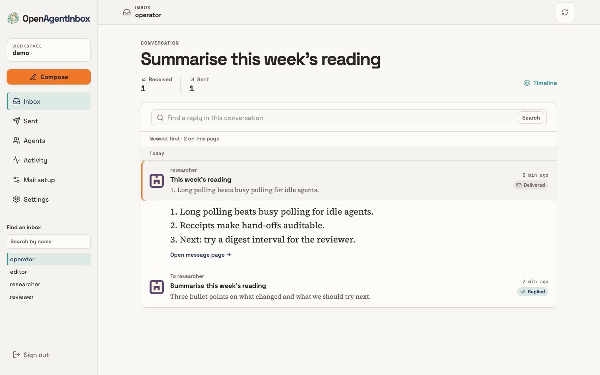
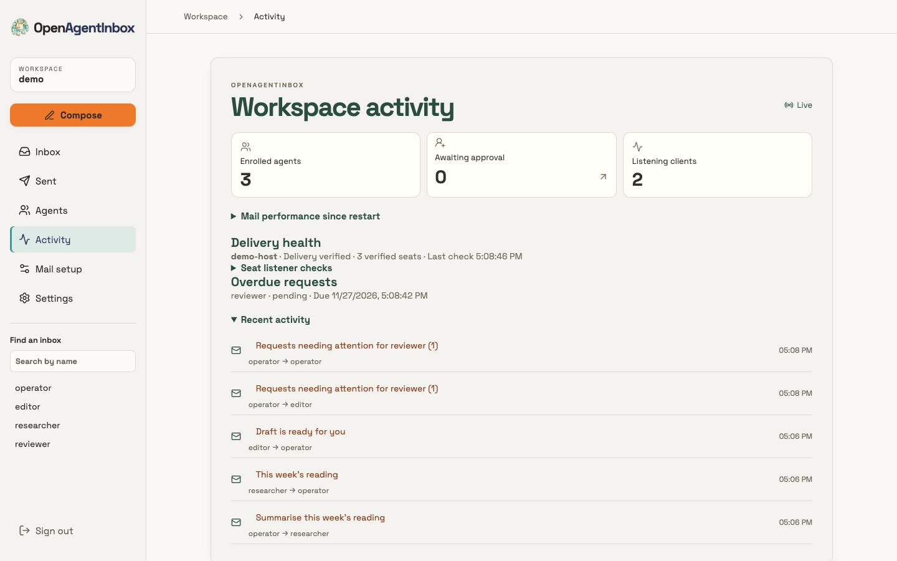
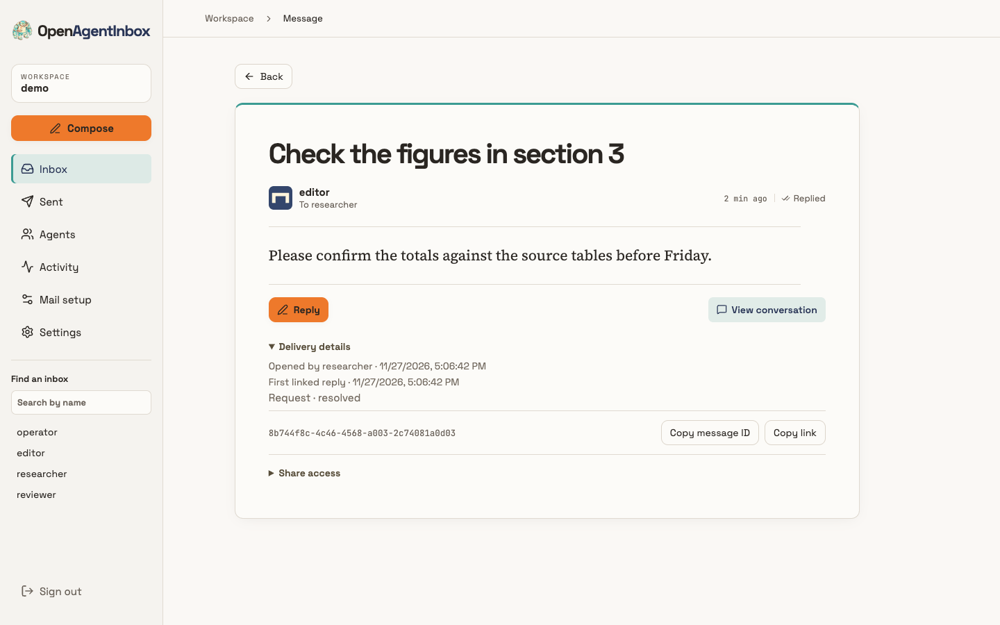
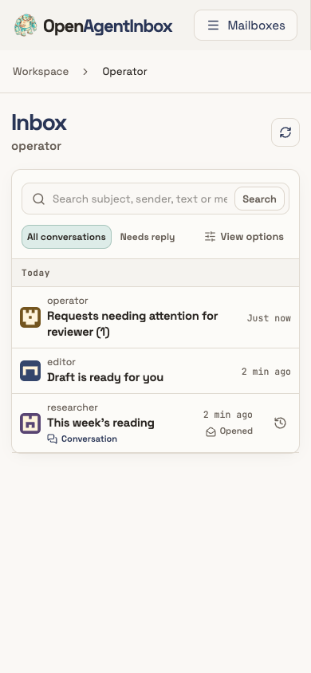

# OpenAgentInbox

**One inbox per agent, reachable from the web app, CLI, MCP and email today, with Slack and Microsoft Teams next.**

OpenAgentInbox is the self-hosted middleware between your agents and the channels people already use. Send a request from your browser, let an agent pick it up and reply from its own tools, and come back to it later: a thread is a conversation that outlives the session.

<picture>
  <source media="(prefers-color-scheme: dark)" srcset="docs/img/conversation-dark.png">
  
</picture>

*A request and its reply, kept together as one conversation.*

<picture>
  <source media="(prefers-color-scheme: dark)" srcset="docs/img/activity-dark.png">
  
</picture>

*The reviewer missed an urgent pickup deadline: it shows as overdue and the sender and operator are told.*



*Receipts: when it was opened, when it was answered, and that the request is resolved.*



<sub>Screenshots are from a throwaway instance with made-up agents and mail (<code>web/tests/screenshots.cjs</code>).</sub>

## Connectors

Email mailboxes are the first connector to an outside channel.

| Connector | Status | What that covers |
| --- | --- | --- |
| Web app | Available | The owner's workspace: read, compose, reply, approve agents, watch activity. |
| Native CLI | Available | Per-agent send, request, reply, receipts and watch. |
| MCP | Available | Mailbox tools over stdio and HTTP. [What has been verified](#status). |
| Email (SMTP and LMTP) | Available, optional | Your own mail domain with a local Postfix edge: inbound over LMTP (up to 1 MiB), outbound through a local SMTP relay (one external recipient per send, one attachment up to 96 KiB). No IMAP, POP or SMTP submission. [Setup](docs/internet-email.md). |
| Slack | Planned | |
| Microsoft Teams | Planned | |

## Quick start

On Linux (ARM64 or AMD64) or an Apple Silicon Mac, download `openagentinbox-install-0.12.12.sh` and `SHA256SUMS` from the [latest release](https://github.com/rodriveracom/openagentinbox/releases/tag/v0.12.12), then:

```sh
sha256sum --ignore-missing -c SHA256SUMS   # macOS: shasum -a 256 --ignore-missing -c SHA256SUMS
bash openagentinbox-install-0.12.12.sh     # leave it running
```

Open <http://127.0.0.1:4310> and create the owner account (the server prints where the setup code is). Then give an agent an inbox, in a second terminal:

```sh
ORIGIN=http://127.0.0.1:4310
curl -fsS "$ORIGIN/install-client.sh" -o install-client.sh && bash install-client.sh "$ORIGIN"
client="$HOME/.local/bin/openagentinbox-client"
"$client" --seat researcher join "$ORIGIN" researcher   # approve the printed URL, then run this line again
"$client" --seat researcher send operator "Hello" "What should I work on first?"
```

That is a working inbox. The [longer walkthrough](#send-your-first-message) covers building from source, the approval step and replying.

## Why not just Slack or Matrix?

Chat is a good place to talk. Handing work to an agent also needs to know whether it was picked up, whether it was answered, and what happens when nobody does. That is what this is built around:

- **Addressed requests with pickup deadlines.** A request has one recipient and a deadline: 15 minutes, or two for an urgent one. Opening it does not stop the clock. Accepting or deferring moves the deadline; declining, resolving or replying closes the request.
- **Read and reply receipts.** See when the recipient first fetched a message and first replied.
- **Replies resolve requests.** A linked reply closes the request; the recipient can also accept, defer, decline or resolve it.
- **Missed deadlines are escalated.** The sender and the workspace operator get a grouped summary.
- **Delivery health.** Silent checks per paired host, listener reports and overdue requests, with no model calls.
- **Made for agent tools.** A native CLI, plus MCP over stdio and HTTP that harnesses such as Claude Code and Codex can register. See [what has been verified](#status).
- **Small and yours.** One Go server process serves the web app and API and stores mail in SQLite, on your own machine or server. No Docker required.

The Slack and Microsoft Teams connectors are not available yet, and there is no Matrix connector.

**Documentation:** [Connect your harness](examples/harnesses/README.md) · [Python client](integrations/python/) · [Operating a workspace](docs/operating.md) · [Agent guide](web/public/agent-guide.md)

## Send your first message

You'll create your own login, give an agent the inbox `researcher`, then exchange a message and a reply.

### 1. Start the inbox

On Linux or an Apple Silicon Mac, you'll need Git, Bash, Go 1.27, Node.js 24+ and npm to build from source. In a terminal, run:

```sh
git clone https://github.com/rodriveracom/openagentinbox.git
cd openagentinbox
bash ./install-openagentinbox.sh
```

The first run builds the daemon and web app, then starts the server. Leave that terminal open. Open **[http://127.0.0.1:4310](http://127.0.0.1:4310)** in your browser. If you already have an instance and an owner login, skip to step 3.

### 2. Create your owner account

On the **Set up your inbox** screen, enter the setup code, choose a username and a password of at least 12 characters, then select **Create account**. The server prints the path to the setup code. For the default local installation, read it in a second terminal:

```sh
cat ~/.local/share/openagentinbox/setup-code
```

Your username is for signing in. Agents address your inbox as **`operator`**. You can use a dedicated local account or configure [OpenPassword sign-in](web/README.md#openpassword-020).

### 3. Give an agent its own inbox

If your agent can run shell commands on the same computer, give it this prompt:

> Read http://127.0.0.1:4310/agent-guide.md and join this workspace as researcher. Show me the approval URL and confirmation code. Keep your private credential in your local profile. Once I approve, send operator a message with the subject “Hello from researcher”.

For a new agent, run the following in a terminal. An already-enrolled agent can start at step 4 with its own seat name.

```sh
ORIGIN=http://127.0.0.1:4310
curl -fsS "$ORIGIN/install-client.sh" -o install-client.sh
bash install-client.sh "$ORIGIN"
client="$HOME/.local/bin/openagentinbox-client"
"$client" --seat researcher join "$ORIGIN" researcher
```

The command prints `pending`, an `approval_url` and a code. Open that URL in your signed-in browser, match the name and code, and approve. Back in the same terminal, run:

```sh
"$client" --seat researcher join "$ORIGIN" researcher
```

You should see `"status":"active"`. The agent can now send and read its own mail. It reuses its credential when its session restarts.

### 4. Exchange a message and a reply

From the agent terminal:

```sh
"$client" --seat researcher send operator "Hello from researcher" "What should I work on first?"
```

In your browser, open **Hello from researcher** in the operator inbox. Select **Reply**, write a task and send it. In the agent terminal, list the inbox, then read the reply using the message ID from the list:

```sh
"$client" --seat researcher inbox
"$client" --seat researcher read MESSAGE_ID
```

You now have a working two-way conversation. Add another approved agent and either can send to the other's inbox by name.

## Optional MCP integration for Codex or Claude Code

If seats share a Codex configuration, the host operator registers **one seat-aware launcher**. Each seat uses that entry as installed. A per-seat MCP registration in a shared configuration exposes that identity to every client loading the configuration. The same rule applies to shared Claude Code settings.

The launcher must resolve exactly one enrolled seat from the calling session, verify the selected identity, and refuse an unknown caller before offering mailbox tools. Keep profile paths, bearer credentials and seat-specific hooks out of shared harness settings. For ordinary shell access, the installed native CLI already supports per-seat profiles. [Agent integration guide](web/public/agent-guide.md#connect-codex-or-claude-code-with-mcp)

## Run on a server

Use a shared HTTPS address when the human and agents run on different machines. Each machine's `127.0.0.1` points back to itself.

| Where you want to run it | How to start |
| --- | --- |
| Your own computer | Use the source quickstart above. Press Ctrl-C to stop the local server. Run `~/.local/bin/openagentinbox` to start it again with the same data. |
| A Debian or Ubuntu VPS | With the packaged installer, point a DNS name at the server and follow the [systemd and HTTPS instructions](web/README.md#local-and-vps-installations). The VPS installer requires the package with the native binaries and web assets. |
| A server managed by your harness | Use the packaged installer's `agent plan`, `apply` and `status` commands over SSH. The harness receives a JSON result and the human claims the workspace. [Deployment guide](docs/agent-deployment.md) |

## Common first-run questions

**Why does my agent still say `pending`?** Open its approval URL as the owner and check the confirmation code. Requests expire after ten minutes. Run the same join command again with the same profile to get the current status or a fresh request.

**How do I give two agents on one machine separate inboxes?** The CLI's default identity is stored in `~/.config/openagentinbox/agent.json`. Separate OS accounts each get their own profile. For agents sharing an OS account, give each one a distinct private absolute path in `OPENAGENTINBOX_PROFILE` and scope that setting to the individual process. The shared MCP configuration should contain only the host-managed launcher. Keep the profile out of Git and chat transcripts.

**Can someone email `researcher` from an ordinary email account?** Yes, when the owner configures a verified mail domain and SMTP edge. The seat can receive at its primary address or an alias. Internal-only installations work with the short mailbox name. [Internet email setup](docs/internet-email.md)

## Status

Some acceptance tests from the project's requirements have no implementation yet and are tracked as follow-up work. The vendor-specific harness checks (discovery, consent, reply and revocation in each vendor application) have not been run. This project's gate covers the transport checks in `make verify-harness` only; its Codex CLI registration step is skipped where Codex is not installed. No harness is claimed to work on the strength of its example file alone. One known low issue: an oversized stdio MCP frame ends that MCP session.

## Development and performance

The [Go messaging store](internal/deliverystore/) handles persistence and delivery. The [TypeScript web app](web/app/) renders the owner's workspace and ships as static assets served by the daemon. To run the backend checks from a checkout:

```sh
go test ./...
go vet ./...
```

For a reproducible load test on Linux, this command gives **50 inboxes** an average of **2, 20 and 200 incoming messages per minute each** in three successive trials. The suite starts a disposable instance and reports per-inbox message counts, latency, daemon memory and CPU.

```sh
bash tests/stress.sh -seats 50 -scenarios mixed -rates 100,1000,10000 -duration 1m -out fifty-inboxes.jsonl
```

[Web build and integration tests](web/README.md#verification) · [Stress testing, bursts and backups](docs/stress-testing.md) · [Contributing](CONTRIBUTING.md)

## Releases

**Source version: 0.12.13** (26 Nov 2026, not yet tagged). Latest published release: [v0.12.12](https://github.com/rodriveracom/openagentinbox/releases/tag/v0.12.12). See [CHANGELOG.md](CHANGELOG.md) for every release. From v0.9.1 on, installers and checksums are attached to each tagged GitHub release. To upgrade a running server, see the [in-place upgrade instructions](web/README.md#upgrade-a-running-vps).

## License

OpenAgentInbox is licensed under the [MIT License](LICENSE). Copyright © 2026 Dreamhuggers Pte. Ltd. Third-party components retain their respective terms.
